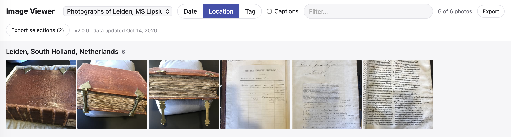
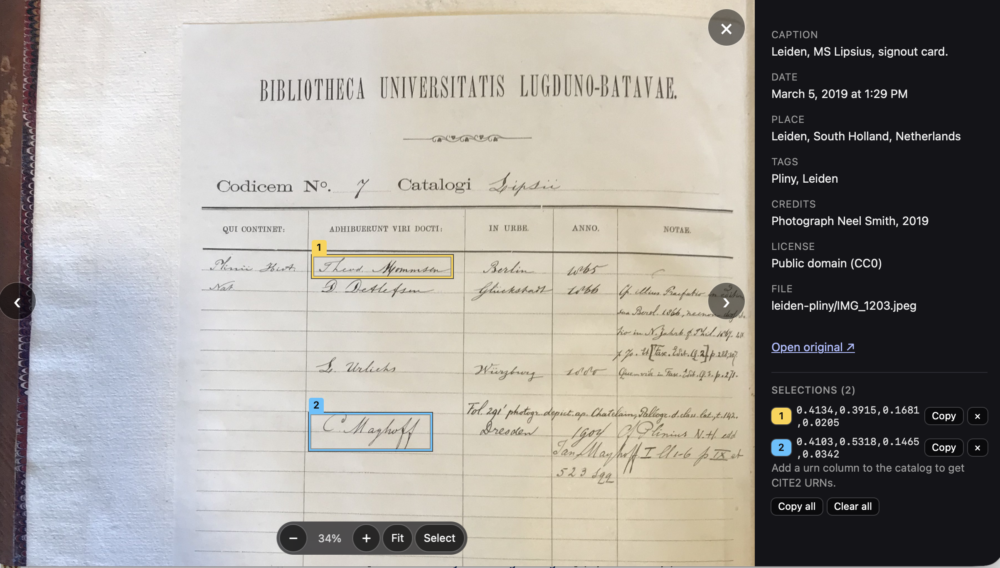

The [`imageviewer` github repository](https://github.com/neelsmith/imageviewer) hosts apps for light-table and zoomable/pannable display of individual images. All the apps are implemented in self-contained HTML files that can be run locally or served on the web. They all support optionally cataloging images in simple delimited-text files. 

In the light-table view, users can filter the selection by cataloged data, or by date and location data encoded in the images. 

{.lightbox}

In the zoomable/pannable view of individual images, users can select and save regions of interest. The apps' URLs allow users to address regions of interest with an HTML `roi` parameter, like [this example](https://neelsmith.github.io/imageviewer/catalogs.html#catalog=data%2Fcatalogs%2Flips7.cex&photo=leiden-pliny%2FIMG_1203.jpeg&roi=0.4134%2C0.3915%2C0.1681%2C0.0205%3B0.4103%2C0.5318%2C0.1465%2C0.0342).

{.lightbox}

The github pages for `imageviewer` hosts an example installation of the [catalogs.html](https://neelsmith.github.io/imageviewer/catalogs.html) app for viewing images by catalog.

Learn more about:

- [browsing local images](./local.qmd)
- [annotating images with a catalog](./cataloging/)
- [canonically citing images](./citable/)
- [sharing images on the web](./servers.qmd)